  
  
  

 

Sou desenvolvedor full stack em Santa Catarina, Brasil. Crio **aplicações web, sistemas internos e automações** para empresas e profissionais que precisam de algo que funcione de verdade: rápido, seguro e fácil de manter.

- **Experiência:** Jovem Aprendiz em Desenvolvimento de Sistemas no Grupo Malwee (2025–2026), com integrações, automações e scripts para SAP GUI
- **Formação:** Engenharia de Software na Estácio (2026–2029) e Técnico em Desenvolvimento de Sistemas no SENAI
- **Idiomas:** português, inglês e espanhol

 

| Projeto | O que é | Stack |
| :-- | :-- | :-- |
| **[Agenda Autônomo](https://github.com/Henrique-konig/Agendamento-Online)** | Agendamento online para autônomos, com lembretes, Google Agenda e Pix | Next.js · TypeScript · Prisma · PostgreSQL |
| **[AportFy](https://github.com/Henrique-konig/AportFy)** [ver online ↗](https://aportfy.vercel.app) | Finanças pessoais e de casal com carteira de investimentos em tempo real | JavaScript · Firebase · Tailwind · Chart.js |
| **[Atmospherix](https://github.com/Henrique-konig/Atmosphere-Analysis-Atmospherix)** [ver online ↗](https://atmosphere-analysis-atmospherix.vercel.app) | Previsão do tempo detalhada, instalável e funcional offline | Next.js · React · TypeScript · Leaflet |

 

**Frontend**

  
  
  
  
  
  
  

**Backend**

  
  
  
  
  

**Dados**

  
  
  
  
  

**Infra e automação**

  
  
  
  
  
  
  

**Qualidade**

  
  

 

  Conte o que você precisa e eu retorno com uma proposta. 
  <a href="mailto:henriquegustavokonig@gmail.com"><strong>henriquegustavokonig@gmail.com</strong></a>

